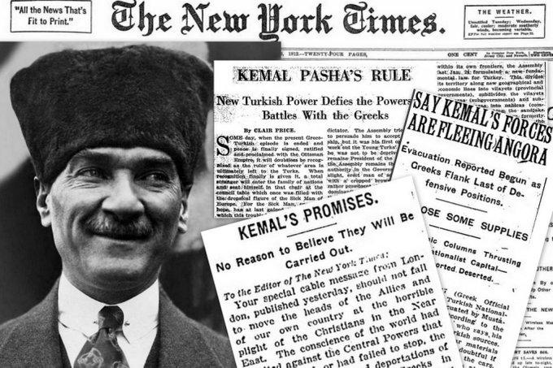
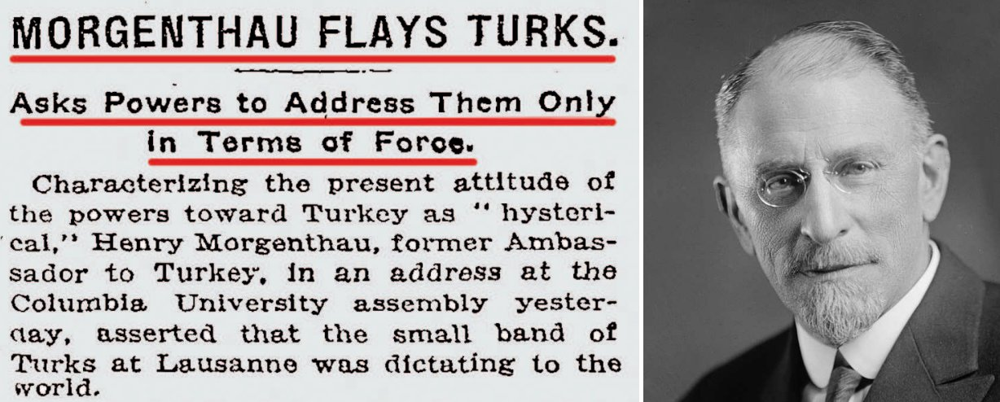
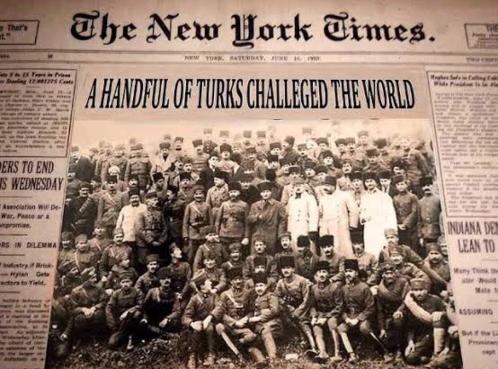
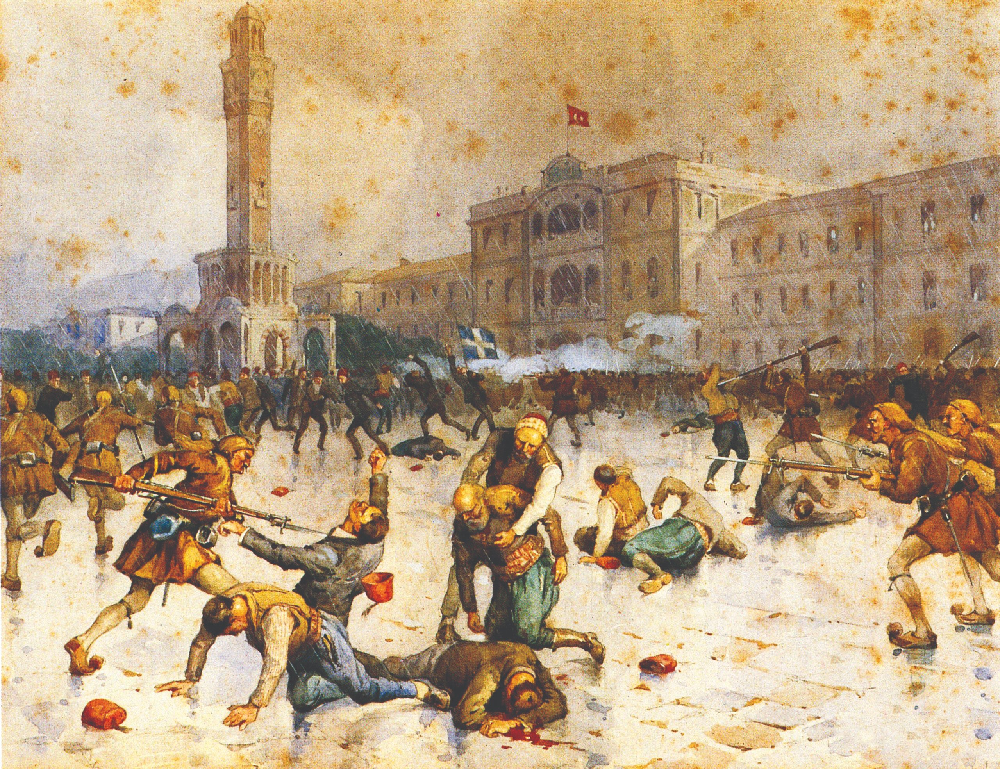
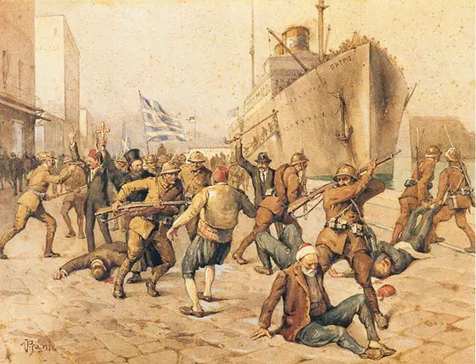
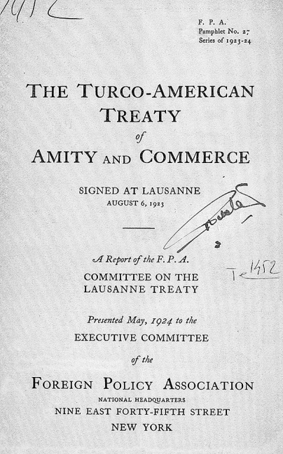
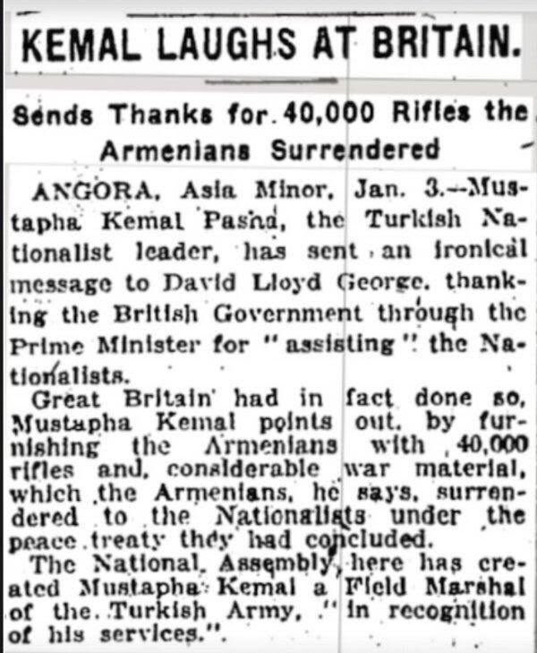

En büyük Türk!

Şuan yattığı yerden bile savaşan ve yenilemeyen Mustafa Kemal.

Ama Kimine göre mason, kimine göre Selanik dönmesi, kimine göre ingiliz, kimine göre Osmanlıyı yıkan adam, kimine göre dedesinin mezar taşını okuyamamasının sebebi. Bunlar saydıkça bitmez.

Açıkçası size göre ne olduğu umrumda bile değil, hakaret etmediğin sürece... çünkü kişiliği hedef alan hakaret, bir fikir değil; ancak minnet duygusunun ve tarih bilgisinin eksikliğidir.
İşte bu tam olarak net bir gerçek ve durum özetidir.

Azıcık minnet duygusu olan bir birey zaten bunları sorgular ve gerçeği görebilir. Ve sonraki Asıl soru şu olur; "Bu kadar iftira neden?"

Mustafa Kemal Atatürk'e yönelik tarihsel ve güncel karalama kampanyaları ile iftiraların arkasında temel sosyo-politik, idolojik ve stratejik nedenler bulunmakta.

Karşımıza bir kaç temel neden çıkıyor;
- Radikal devrimler sonrası değişime tepki
- Eşit vatandaşlık haklarının feodalitenin işine gelmemesi (devlet yapısındaki değişiklik)
- Emperyalizm karşıtlığının yarattığı rahatsızlık
- Toplumsal hafıza kaybı, milli şuurun zayıflaması

Bu temel nedenleri destekleyecek argümanlarında olması lazım. Ve bunlardan biri The New York Times gazetesi haberleri.

Bir dönem (6 Ağustos 1923) abd ve Türkiye arasında ticari antlaşmayı engellemek için kara propaganda aracı olarak kullanılan bu gazete, amerikanın en büyük gazetelerinden. 1923-1927 arası 4 yıllık süreçte; Amerika'daki Türkiye karşıtları, Amerikan kamuoyunun ve senatosunun antlaşmaya karşı çıkmasını sağlamak için New York Times gazetesi etkin bir kara propaganda aracı olarak kullandı.

---

03.02.1922 - "Senatör King:  Mustafa Kemal denilen haydudun vahşet ve zulmüne karşı çıkmalıyız."

02.04.1922 - "Prof. Duggan: Türkler Avrupa'dan çekilip asıl yurtları olan Anadolu'nun bir köşesine  yerleşmedikçe Yakın Doğu sorunu son bulmayacaktır. Türkler uygarlığa hiç bir katkıda bulunmayan bir işgal ordusu olarak yıllardır Avrupa topraklarında bulundular."

17.05.1922 - Tarihli yayında; Yunanlar bazı hatalı davranışlarına rağmen, vahşi Türklerle  karşılaştırılamayacak kadar uygar insanlardır. Bu iki ulusun uygarlık düzeyleri arasında bir kaç binyıllık bir fark bulunduğunu rahatlıkla söyleyebiliriz. Türkler 1915'de Ermenileri yok etmek amacıyla  kullandıkları yöntemi şimdi de Anadolu'daki Rumlara uyguluyorlar. Uyguladıkları yöntem gayet basit:  Hristiyan kardeşlerimizi ölene dek yürümeye zorlamak. Yunanların da zaman zaman Türkleri kurşunlamış oldukları bir gerçektir. Ancak Yunanların Anadolu'da Türklere  yaptığı katliamlar çok daha küçük çapta ve anlık bir öfkenin sonucu olarak meydana gelmiştir. Oysa Türkler Hristiyan azınlıkları yok etmek amacıyla sistematik olarak öldürmektedirler. Mustafa Kemal'in ordusu Türkiye'de söz sahibi olarak kaldığı ve güçlü bir Avrupa devleti, Mustafa Kemal'i temizlemeye kesin karar vermediği sürece, Türkiye sorununa bizleri tatmin edecek bir çözüm yolu bulunamaz.

31.08.1922 Tarihli yayında; "Yunan orduları Mustafa Kemal'i durduramadığı takdirde Yunanistan'ın desteğiyle Ege bölgesinde kurulması tasarlanan bağımsız 'İyonya Devleti' bir hayal olacaktır. Avrupa uygarlığının beşiği olan bu topraklar bir kez daha Asyalıların eline geçer ve bir milyona yakın Hristiyan kardeşimizin geleceği katil Türklerin insafına bırakılırsa bu cinayetin başlıca sorumluları Yunanistan ile birlikte İtalya ve Fransa olacaktır."

02.10.1922 Tarihli yayında; "Anadolu'daki savaşın Türklerin zaferiyle son bulması yakın tarihin en korkunç olayıdır. Korkunç Türk bütün vahşetiyle  yeniden sahneye çıkmıştır. Bu şartlar altında susmayı yeğlemek,  uygar insan sınıfına yükselememiş yarı vahşilerle işbirliği yapmak  anlamına gelecektir."

10.01.1923 - "ABD'nin eski Türkiye Büyükelçisi Henry Morgenthau, Lozan'da bir avuç Türk'ün bütün dünyaya hükmettiğini ileri sürmüştür." "Amerika halkı artık sesini duyurmalı ve korku içindeki Senato'ya isteklerini bildirmelidir. 400 yıldır Türkleri Avrupadan kovmak için çaba harcayan Avrupalılar için Lozan, çok acı bir ders olmuştur. Türklerin Avrupa'dan kovulması şöyle dursun, Avrupalıların Türkiye'den kovulacağı anlaşılmaktadır. Türkiye'de bugüne dek yapılan bütün katliamlar bilinçli olarak yapılmıştır. Türklerin amacı toprakları üzerinde yaşayan azınlıkları ortadan kaldırmaktır. Türkleri yola getirmenin tek yolu onlara karşı silaha başvurmaktır. Çünkü bu millet yalnız ve yalnız zorbalıktan ders almaktadır."

28.11.1923 Tarihli yayında Henry Morgenthau şöyle diyor; "ABD İngiltere ile birlikte İzmir'e asker çıkartmış olsaydı Türklerin Avrupa'dan kovulması gerçekleşebilecekti."

- O günlerde insanlarımızı katlettiğiniz yetmezmiş gibi...

07.10.1923 Tarihli yayında; "Savaş öncesi dönemde Türkiye'deki ticari faaliyetlerin %85'i Ermeni ve Rumların elinde bulunuyordu. Türkler ne yapıp edip Rumların geri gelmesini ve ticari hayata el koymasını sağlamalıdırlar."
Tüm bu tepkilerin bir diğer nedeni; Türkiye ile ABD arasında 6 Ağustos 1923 günü Lozan'da imzalanan ve yürürlüğe girmesini istemedikleri ticari antlaşma. Ve tabi ABD senatosu onaylamadığı için yürürlüğe girmedi.

Türklüğe, Atatürk'e, Kurtuluş Savaşımıza ve Cumhuriyetimize karşı kin, nefret, düşmanlık, öfke tohumları o günden ekildi.

Kemalist ifadesi ilk kez Milli Mücadele yıllarında ingilizler tarafından, kendilerine hem diplomasiyle hemde savaşta kök söktüren Türk topluluğunu ifade edebilmek için kullanımıştır...

Tarihsel kökeniyle İngiliz emperyalizmine karşı namusunu savunan Türkleri tanımlayan ifadedir.

-------------------------------

''Ermenilere verdiğiniz 40 bin silah ve mühimmat için teşekkür ederiz, hepsini teslim aldık'' 

I.Dünya Savaşı'nda Rusya ayrılınca, Kafkas bölgesindeki Ermeni Devleti tezi İngilizlerce desteklendi ve silah yardımı yapıldı. Kazım Karabekir'in bölgeye gönderilmesiyle Ermeniler yenilmiş ve Gümrü Antlaşmasını imzalayarak bu topraklardan çekilmek zorunda kalmıştı.İngilizlerin verdiği Ermeni cephanesine de bu sırada el konulur.

Mustafa Kemal derhal bir mektup hazırlanmasını söyler. Mektup şöyledir: ''Ermenilere verdiğiniz 40 bin silah ve mühimmat için teşekkür ederiz, hepsini teslim aldık.''

New York Times gazetesi ise “Kemal, İngiltere'ye Gülüyor." diyerek Gazi'nin Britanya ile adeta dalga geçtiği yazar.  “Milliyetçi Türk Lider Mustafa Kemal Paşa Lloyd George'a göndermiş olduğu alaycı mesajında, milliyetçi Türklere yardım ettiği için İngiliz Hükümeti'ne teşekkür etti.”

-------------------------------

Mustafa Kemal Atatürk’ün günlüklerinde (özellikle 1916-1917 Doğu Cephesi dönemine ait notlarında) yer alan "Hafıza Kur'an okuttuk" veya "Hafızlara Kur'an okuttum" şeklindeki ifadeler, hem o dönemin şartları hem de Atatürk’ün kişisel/askeri yaklaşımı açısından birkaç önemli noktaya dayanır.

İşte bu durumun temel nedenleri:

1. Maneviyat ve Ordu Morali
O dönemde Osmanlı ordusu, çok ağır savaş koşulları (Birinci Dünya Savaşı) altındaydı. Askerin moralini yüksek tutmak, vatan savunması motivasyonunu güçlendirmek için dini değerler en büyük dayanaktı. Atatürk, bir komutan olarak askerinin psikolojisini çok iyi biliyordu. Şehitler için Kur'an okutmak veya dini törenler düzenlemek, birliğin manevi gücünü ve birbirine olan bağlılığını artırıyordu.

2. Vefat Eden Silah Arkadaşlarına Hürmet
Günlüklerindeki bu ifadeler genellikle bir çatışma, kayıp veya önemli bir günün ardından gelir. Hayatını kaybeden subay ve erlerin ruhuna duyulan saygı ve vefa gereği, o dönemin geleneklerine uygun olarak Kur'an okutulmasını sağlamıştır. Bu, sadece dini bir görev değil, aynı zamanda bir "askeri gelenek" ve liderlik duruşudur.

3. Kendi Kültürel ve Dini Birikimi
Atatürk, dini bilgisi oldukça yüksek bir liderdi. Kur'an'ın içeriğine, İslam tarihine ve felsefesine hakimdi. Günlüklerinde sadece Kur'an okutmaktan değil, bazen okunan ayetlerin anlamları üzerine düşüncelerinden de bahseder. Dolayısıyla bu uygulama, onun çocukluğundan itibaren içinde yetiştiği kültürel dokunun ve inanç dünyasının doğal bir yansımasıdır.

4. Toplumsal Mutabakat ve Liderlik
Milli Mücadele ve öncesindeki süreçte halkı ve orduyu bir arada tutan en güçlü tutkal İslamiyet’ti. Atatürk, toplumun değerleriyle çatışan değil, bu değerleri vatan savunması yolunda birleştiren bir liderlik sergilemiştir.

Önemli Not: Atatürk’ün günlüklerindeki bu notlar, onun sadece askeri bir deha değil, aynı zamanda emrindeki insanların manevi dünyasına kıymet veren, geleneklerine bağlı bir insan olduğunu göstermesi açısından tarihçiler için kıymetli belgelerdir.

Özellikle 8 Kasım 1916 tarihli not defterinde, Hafız’a Kur'an okuttuğundan ve duyduğu huzurdan bahsetmesi, onun o dönemdeki iç dünyasına dair samimi bir kesittir.

Cumhuriyet döneminde de bu tür faaliyetleri hem kişisel hayatında hem de devlet nezdinde devam etmiştir. Ancak Cumhuriyet ile birlikte bu durum, kişisel bir maneviyattan ziyade "dinin halk tarafından öz dilinde anlaşılması" ve "kurumsal bir yapıya kavuşturulması" vizyonuna dönüşmüştür.

İşte Cumhuriyet döneminden öne çıkan örnekler:

1. Çankaya Köşkü ve Ramazan Gelenekleri
Atatürk'ün özel hayatında Ramazan aylarının ayrı bir yeri vardı. Cumhurbaşkanlığı İnce Saz Heyeti Şefi Hafız Yaşar Okur’un anılarında belirttiği üzere:

Ramazan'da Musiki Yasağı: Ramazan ayı boyunca Çankaya Köşkü’ne ince saz (eğlence musikisi) giremezdi.

Hafızlarla Buluşma: Kandil gecelerinde ve Ramazan akşamlarında köşkün muayede salonunda veya özel odasında devrin ünlü hafızlarını (Hafız Yaşar, Hafız Sadettin Kaynak, Hafız Kemal vb.) toplar, onlara Kur'an ve Mevlid okuturdu.

Huşu İçinde Dinleme: Hafız Yaşar Okur, Atatürk’ün Kur'an okunurken derin bir sessizliğe büründüğünü ve büyük bir dikkatle dinlediğini aktarır.

2. Şehitler İçin Hatimler
Atatürk, Cumhuriyet döneminde de şehitleri anma konusunda çok hassastı. Her yıl Ramazan ayında Ankara'daki Hacı Bayram-ı Veli Camii ve Zincirlikuyu Camii'nde şehitlerin ruhuna hatm-i şerif okunmasını emreder ve bu hatimlerin usulüne uygun şekilde tamamlanmasını takip ederdi.

3. Kız Kardeşi Makbule Hanım ile İftarlar
Atatürk, her Ramazan’ın bir günü (genellikle Kadir Gecesi) kız kardeşi Makbule Atadan’ın evine iftara giderdi. Makbule Hanım'ın anlatımlarına göre, o günlerde eğer sağlığı el verirse oruç tutmaya özen gösterir ve iftar sofrasının tam bir "eski tarz" Türk sofrası olmasını isterdi. Ayrıca annesi Zübeyde Hanım'ın ruhu için hafızlara hatim indirtir ve hafızın hakkını bizzat kendi cebinden bir zarf içinde verirdi.

4. Dini Bilginin Yayılması (Kurumsal Faaliyetler)
Cumhuriyet dönemindeki "Kur'an okutma" eylemi sadece dinleme odaklı kalmamış, halkın okuduğunu anlaması için büyük projelere dönüşmüştür:

Elmalılı Hamdi Yazır Tefsiri: Atatürk, Kur'an'ın en doğru şekilde anlaşılması için Elmalılı Hamdi Yazır’a meşhur Hak Dini Kur'an Dili tefsirini kendi cebinden ödenek ayırarak hazırlatmıştır.

Türkçe Kur'an ve Ezan Denemeleri: 1932 yılında İstanbul Yerebatan Camii'nde Hafız Yaşar Okur'a ilk Türkçe Kur'an tercümesini okutmuş, halkın dinin özünü kendi dilinde duymasını amaçlamıştır.

Hafız Yetiştirme: Diyanet İşleri Başkanlığı aracılığıyla "Darü'l-Huffaz" (Hafız yetiştirme okulları) için bütçe ayırmış ve ehil din adamlarının yetişmesini desteklemiştir.

Özetle; Atatürk için Kur'an ve hafızlık, sadece savaş meydanlarında moral veren bir unsur değil, Cumhuriyet döneminde de hem kişisel bir saygı ifadesi hem de Türk milletinin dini aslından öğrenmesi gereken bir kültürel/manevi miras olarak kalmıştır.

Bu konuyla ilgili en temel ve en kapsamlı birincil kaynak, Atatürk’ün 1924-1938 yılları arasında Cumhurbaşkanlığı İnce Saz Heyeti Şefliği görevini yürüten Hafız Yaşar Okur’un bizzat kaleme aldığı anılarıdır.

Hafız Yaşar Okur, bu hatıralarını önce 1950'li yıllarda çeşitli gazetelerde tefrika etmiş, daha sonra bu notlar "Atatürk'le On Beş Yıl: Dinî Hatıralar" adıyla kitaplaştırılmıştır.

1. Belge ve Kaynakça Bilgileri
Ana Kaynak: Yaşar Okur, Atatürk'le On Beş Yıl: Dinî Hatıralar, İstanbul 1962.

Destekleyici Kaynak: Kılıç Ali, Atatürk'ün Hususiyetleri, İstanbul 1955. (Kılıç Ali, Atatürk’ün sofrasındaki dini sohbetleri ve Kur’an dinleme seanslarını doğrular.)

Resmi Kayıtlar: Cumhurbaşkanlığı Arşivi'nde, özellikle Ramazan aylarında köşke davet edilen hafızlara yapılan ödemeler ve verilen hediyelere dair harcırah kayıtları mevcuttur.

2. Belgelere Dayanan Önemli Tarihler ve Olaylar
22 Ocak 1932: Yerebatan Camii ve "Hafızlar Meclisi" Hazırlığı
Atatürk, dinin öz Türkçesiyle anlaşılması projesi kapsamında devrin en ünlü hafızlarını Dolmabahçe Sarayı'nda toplamıştır. Hafız Yaşar Okur, hatıralarında o geceyi şöyle anlatır:

"Sarayda hazırlanan bir odada Hafız Kemal, Hafız Sadettin Kaynak, Hafız Fahri, Hafız Burhan ve ben bulunuyorduk. Paşa geldi, Kur'an'ın Türkçeleşmesi ve halkın bunu anlaması üzerine uzun uzun konuştu. O gece bize Kur'an okuttu ve tilavetimizi dikkatle dinledi."

1932 Ramazan ayı: Dolmabahçe ve Çankaya
Hafız Yaşar Okur’un aktardığına göre, 1932 yılından vefatına kadar geçen süreçte her Ramazan ayında rutin bir uygulama mevcuttu:

Uygulama: Ramazan'ın ilk gününden itibaren iftardan sonra veya sahurdan önce uygun vakitlerde Kur'an okunurdu.

Mevlid Notu: Atatürk'ün özellikle annesi Zübeyde Hanım'ın vefat yıldönümlerinde (14 Ocak) ve Kandil gecelerinde Süleyman Çelebi’nin Vesiletü'n-Necat (Mevlid) eserini, özellikle "Veladet" bölümünü Hafız Yaşar'a okuttuğu, "Susunuz, şimdi Peygamber doğuyor" diyerek cemaati sessizliğe davet ettiği kayıtlara geçmiştir.

3. Kaynaklardaki Spesifik Detaylar
Hafız Yaşar Okur'un hatıralarında geçen bazı dikkat çekici "belge niteliğindeki" ifadeler şöyledir:

İnce Saz ve Kur'an: "Ramazanlarda Köşk’e musiki giremezdi. Saz heyeti o ay tatil yapardı. Fakat Paşa, biz hafızları yanından ayırmaz, sık sık Kur'an okutur ve 'Yâsin' suresini çok sevdiğini söylerdi."

Hafız Sadettin Kaynak ve Mevlid: 1930'lu yılların ortalarında Atatürk, Sadettin Kaynak'a Mevlid'in bazı bölümlerini "bestelemeden, sadece kelimelerin hakkını vererek" okuması talimatını vermiş ve bunun camilerde nasıl uygulanabileceği üzerine çalışmıştır.

Özetle
Bu bilgiler sadece birer anlatı değil; Hafız Yaşar Okur, Münir Nurettin Selçuk ve Sadettin Kaynak gibi o dönemin şahitlerinin anılarında; ayrıca o dönemin Cumhuriyet ve Vakit gibi gazetelerinin Ramazan eklerindeki röportajlarda tarih ve yer zikredilerek doğrulanmış olaylardır. Atatürk'ün bu ilgisi, dini sadece bir ritüel olarak değil, Türk kültürü ve musikisinin zirve noktalarından biri olarak görmesinden kaynaklanıyordu.

